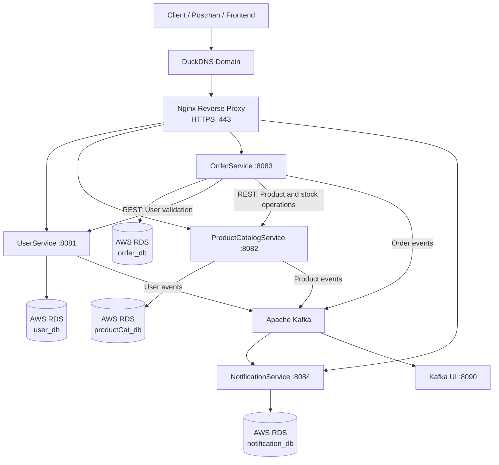
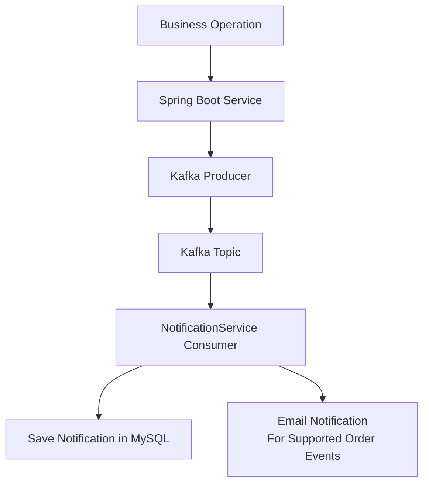

# 🌾 Krushi Sarjana – Agri E-Commerce Microservices Platform

**Krushi Sarjana** is a cloud-deployed agricultural e-commerce platform built using **Spring Boot Microservices, Apache Kafka, Docker, and AWS**.

The platform follows a microservices architecture in which independent services handle user management, product catalog management, order processing, and notifications. Services communicate through REST APIs for synchronous operations and Apache Kafka for asynchronous event-driven communication.

The application is containerized using Docker Compose, uses AWS RDS for persistent MySQL storage, and is exposed through an Nginx reverse proxy with HTTPS.

---

## 🚀 Key Features

- **Microservices Architecture:** Independent Spring Boot services with clearly separated responsibilities.
- **JWT Authentication:** Token-based authentication for protected APIs.
- **Role-Based Access:** Supports FARMER, SELLER, and CUSTOMER roles.
- **Product Management:** Product creation, retrieval, updating, deletion, and category-based filtering.
- **Order Management:** Order placement, order tracking, cancellation, and status management.
- **Event-Driven Communication:** Apache Kafka enables asynchronous communication between microservices.
- **Notification System:** Consumes Kafka events and manages user notifications.
- **Cloud Database:** AWS RDS MySQL with separate databases for individual services.
- **API Gateway:** Nginx provides a unified public entry point for backend services.
- **HTTPS:** Free SSL/TLS certificates through Let's Encrypt and Certbot.
- **Containerization:** Docker and Docker Compose simplify service deployment and management.

---

## 🏗️ System Architecture

The application follows a distributed microservices architecture.



### Architecture Components

| Component | Responsibility |
|---|---|
| Client | Sends HTTP requests to backend APIs |
| DuckDNS | Maps the domain to the EC2 public IP |
| Nginx | Reverse proxy, request routing, and HTTPS termination |
| UserService | Authentication, users, and JWT generation |
| ProductCatalogService | Product and category management |
| OrderService | Order lifecycle and stock coordination |
| NotificationService | Notification persistence and event consumption |
| Apache Kafka | Asynchronous event streaming |
| AWS RDS | Persistent MySQL databases |
| Docker Compose | Container orchestration |
| Kafka UI | Kafka topic and consumer monitoring |

---

## 🧩 Microservices Overview

### 1. UserService

Responsible for user authentication and user management.

**Responsibilities:**
- User registration and login.
- JWT token generation.
- User profile management.
- Role-based access control.
- Internal user lookup for other services.
- Publishing user-related Kafka events.

**Technology:** Spring Boot, Spring Security, JWT, Spring Data JPA, MySQL, Apache Kafka.

**Port:** `8081`

### 2. ProductCatalogService

Responsible for managing agricultural products and categories.

**Responsibilities:**
- Create agricultural products.
- Retrieve products based on user roles.
- Retrieve products by ID and category.
- Update and delete products.
- Reserve and release product stock.
- Publish product-related Kafka events.

**Technology:** Spring Boot, Spring Data JPA, MySQL, Apache Kafka.

**Port:** `8082`

### 3. OrderService

Responsible for managing the order lifecycle.

**Responsibilities:**
- Place customer orders.
- Validate users through UserService.
- Communicate with ProductCatalogService.
- Reserve and release product stock.
- Retrieve customer and seller orders.
- Cancel orders and update order status.
- Publish order-related Kafka events.

**Technology:** Spring Boot, Spring Data JPA, MySQL, Apache Kafka, REST APIs.

**Port:** `8083`

### 4. NotificationService

Responsible for consuming events and managing notifications.

**Responsibilities:**
- Consume user events.
- Consume product events.
- Consume order events.
- Store notifications in its database.
- Retrieve user notifications.
- Track unread notifications.
- Send email notifications for supported order events when email details are available.

**Technology:** Spring Boot, Spring Kafka, Spring Data JPA, MySQL, Java Mail.

**Port:** `8084`

---

## 🔄 Inter-Service Communication

The architecture uses two communication mechanisms.

### 1. Synchronous Communication – REST APIs

REST APIs are used when a service needs an immediate response from another service.

For example, when a customer places an order:

1. OrderService receives the order request.
2. It communicates with UserService to validate user information.
3. It communicates with ProductCatalogService to validate product information and reserve stock.
4. OrderService processes and persists the order.
5. An order event is published to Kafka.

Internal communication uses Docker Compose service names rather than `localhost`.

| Source | Destination | Internal URL |
|---|---|---|
| OrderService | UserService | `http://user-service:8081` |
| OrderService | ProductCatalogService | `http://product-service:8082` |

An internal user lookup endpoint is available:

`GET /internal/users/{userId}`

It uses the `X-Internal-Service-Key` header for internal service authentication.

Stock reservation and release endpoints also use this internal service key.

### 2. Asynchronous Communication – Apache Kafka

Apache Kafka is used for event-driven communication between services.

Instead of directly calling NotificationService whenever an event occurs, the producing service publishes an event to Kafka. NotificationService consumes the event independently.

**Kafka topics:**

| Topic | Producer | Consumer |
|---|---|---|
| `user-events` | UserService | NotificationService |
| `product-events` | ProductCatalogService | NotificationService |
| `order-events` | OrderService | NotificationService |

**Event communication flow:**



**Why Kafka?**

- Reduces direct dependencies between services.
- Enables asynchronous processing.
- Improves service decoupling.
- Allows consumers to process events independently.
- Supports event-driven architecture.

Kafka uses the internal Docker network address:

`kafka:29092`

Kafka UI is available through an SSH tunnel to port `8090` rather than being exposed publicly.

---

## 🌐 Nginx API Gateway

Nginx acts as the reverse proxy and unified entry point for the backend microservices.

Instead of exposing separate backend URLs to clients, requests are routed through a single domain.

**Public base URL:**

`https://krushisarjana.duckdns.org`

### API Routing Configuration

| Public route | Destination |
|---|---|
| `/auth/**` | UserService – `8081` |
| `/api/users/**` | UserService – `8081` |
| `/api/products/**` | ProductCatalogService – `8082` |
| `/api/orders/**` | OrderService – `8083` |
| `/api/notifications/**` | NotificationService – `8084` |

### Example API Requests

**User Authentication**

```http
POST https://krushisarjana.duckdns.org/auth/login
```

**User Registration**

```http
POST https://krushisarjana.duckdns.org/auth/register
```

**Get All Products**

```http
GET https://krushisarjana.duckdns.org/api/products
```

**Create Product**

```http
POST https://krushisarjana.duckdns.org/api/products
```

**Place Order**

```http
POST https://krushisarjana.duckdns.org/api/orders
```

**Get Customer Orders**

```http
GET https://krushisarjana.duckdns.org/api/orders/my-orders
```

**Get User Notifications**

```http
GET https://krushisarjana.duckdns.org/api/notifications/user/{userId}
```

Protected endpoints require a valid JWT Bearer token.

### HTTPS Configuration

HTTPS is enabled using:

- Let's Encrypt – Free SSL/TLS certificates.
- Certbot – Certificate generation and renewal.
- Nginx – SSL termination and HTTP-to-HTTPS redirection.
- DuckDNS – Free domain name and DNS mapping.

---

## ☁️ AWS Deployment Architecture

The backend is deployed on Amazon Web Services.

### AWS Services Used

| AWS Service | Usage |
|---|---|
| Amazon EC2 | Hosts Docker, Nginx, and application containers |
| Amazon RDS | Managed MySQL database |
| EC2 Security Groups | Network access control |
| DuckDNS | Domain mapping to EC2 public IP |
| Let's Encrypt | HTTPS certificates |

### Database Architecture

Each microservice has its own logical MySQL database on AWS RDS.

| Microservice | Database |
|---|---|
| UserService | `user_db` |
| ProductCatalogService | `productCat_db` |
| OrderService | `order_db` |
| NotificationService | `notification_db` |

This separation supports independent data ownership and reduces direct database coupling between services.

---

## 🐳 Docker and Containerization

Each Spring Boot microservice has its own Dockerfile.

The services are built using multi-stage Docker builds:

1. Maven and Java 17 are used to compile and package the application.
2. The generated JAR is copied into a lightweight Java 17 runtime image.
3. Each service runs independently inside its own container.

### Project Structure

```text
Krushi_Sarjana_SpringBoot/
│
├── UserService/
│   ├── src/
│   ├── Dockerfile
│   ├── .dockerignore
│   └── pom.xml
│
├── ProductCatlogService/
│   ├── src/
│   ├── Dockerfile
│   ├── .dockerignore
│   └── pom.xml
│
├── OrderService/
│   ├── src/
│   ├── Dockerfile
│   ├── .dockerignore
│   └── pom.xml
│
├── NotificationService/
│   ├── src/
│   ├── Dockerfile
│   ├── .dockerignore
│   └── pom.xml
│
├── kafka/
│   └── docker-compose.yml
│
├── docker-compose.yml
├── .env
└── .gitignore
```

The root Docker Compose configuration orchestrates the application services, Kafka, and Kafka UI.

---

## ⚙️ Deployment Process – AWS EC2

The following steps describe the deployment workflow.

### Prerequisites

- AWS EC2 Ubuntu instance.
- AWS RDS MySQL instance.
- Docker Engine.
- Docker Compose.
- Git.
- Nginx.
- A DNS name.
- Certbot.

### Step 1: Connect to EC2

```bash
ssh -i "your-key.pem" ubuntu@YOUR_EC2_PUBLIC_IP
```

### Step 2: Install Docker

```bash
sudo apt update
sudo apt install docker.io docker-compose-v2 git -y
```

Enable Docker:

```bash
sudo systemctl enable --now docker
```

Verify:

```bash
docker --version
docker compose version
```

### Step 3: Clone the Repository

```bash
git clone https://github.com/sanyogjadhav24/Krushi_Sarjana_SpringBoot.git

cd Krushi_Sarjana_SpringBoot
```

Use the `main` branch:

```bash
git checkout main
git pull origin main
```

### Step 4: Configure Environment Variables

Create a root `.env` file:

```bash
nano .env
```

Configure the required variables:

```env
DB_USERNAME=your_database_username
DB_PASSWORD=your_database_password

USER_DB_URL=jdbc:mysql://YOUR_RDS_ENDPOINT:3306/user_db
PRODUCT_DB_URL=jdbc:mysql://YOUR_RDS_ENDPOINT:3306/productCat_db
ORDER_DB_URL=jdbc:mysql://YOUR_RDS_ENDPOINT:3306/order_db
NOTIFICATION_DB_URL=jdbc:mysql://YOUR_RDS_ENDPOINT:3306/notification_db

JWT_SECRET=your_jwt_secret
JWT_EXPIRATION=your_jwt_expiration

INTERNAL_SERVICE_SECRET=your_internal_service_secret

MAIL_USERNAME=your_email
MAIL_PASSWORD=your_email_app_password
```

Secure the file:

```bash
chmod 600 .env
```

**Important:** Never commit `.env` or expose database passwords, JWT secrets, internal service keys, or email app passwords in GitHub.

### Step 5: Build and Start Containers

Validate Docker Compose configuration:

```bash
docker compose config --quiet
```

Build all services:

```bash
docker compose build
```

Start the application:

```bash
docker compose up -d
```

Check running containers:

```bash
docker compose ps
```

View application logs:

```bash
docker compose logs -f
```

View individual service logs:

```bash
docker compose logs -f user-service
docker compose logs -f product-service
docker compose logs -f order-service
docker compose logs -f notification-service
```

### Step 6: Install and Configure Nginx

```bash
sudo apt update
sudo apt install nginx -y
```

Enable and start Nginx:

```bash
sudo systemctl enable --now nginx
```

Create a site configuration:

```bash
sudo nano /etc/nginx/sites-available/krushi-sarjana
```

Configure reverse proxy locations for the application routes and their corresponding Spring Boot service ports.

Enable the site:

```bash
sudo ln -s /etc/nginx/sites-available/krushi-sarjana /etc/nginx/sites-enabled/
```

Validate and reload:

```bash
sudo nginx -t
sudo systemctl reload nginx
```

### Step 7: Configure HTTPS

Install Certbot:

```bash
sudo apt install certbot python3-certbot-nginx -y
```

Generate the SSL certificate:

```bash
sudo certbot --nginx -d YOUR_DOMAIN
```

Test automatic renewal:

```bash
sudo certbot renew --dry-run
```

### Step 8: Verify Deployment

Check application containers:

```bash
docker compose ps
```

Check Nginx:

```bash
sudo systemctl status nginx
```

Test the public gateway:

```bash
curl -I https://YOUR_DOMAIN
```

Test a backend API:

```bash
curl -i https://YOUR_DOMAIN/api/products
```

Protected APIs should be tested with a valid JWT token.

---

## 📊 Technology Stack

| Category | Technologies |
|---|---|
| Backend | Java 17, Spring Boot |
| Security | Spring Security, JWT |
| Microservices | Spring Boot REST APIs |
| Database | MySQL, AWS RDS |
| ORM | Spring Data JPA, Hibernate |
| Messaging | Apache Kafka |
| Containerization | Docker, Docker Compose |
| API Gateway | Nginx |
| Cloud | AWS EC2, AWS RDS |
| Domain | DuckDNS |
| HTTPS | Let's Encrypt, Certbot |
| Version Control | Git, GitHub |
| Testing | Postman |

---

## 🔐 Security Considerations

- JWT-based authentication for protected APIs.
- Shared internal service key for selected internal endpoints.
- Environment variables for secrets and database credentials.
- HTTPS encryption through Let's Encrypt.
- Nginx as the public entry point.
- AWS Security Groups for network access control.
- Kafka and database credentials must not be committed to source control.

For production deployments, backend ports should not be publicly accessible. RDS should accept database traffic only from authorized application infrastructure, and SSH access should be restricted to trusted IP addresses.

---

## 🧪 Testing

The deployment can be verified using Postman and command-line tools.

| Test | Expected result |
|---|---|
| User registration | Successful registration |
| User login | JWT token returned |
| Product creation | Product persisted in RDS |
| Product retrieval | Product data returned |
| Order placement | Order processed and persisted |
| User validation | Successful internal service communication |
| Product stock reservation | Stock updated through ProductCatalogService |
| Kafka event publishing | Event delivered to the appropriate topic |
| Notification consumption | Notification persisted |
| HTTPS request | Successful secure gateway response |

---

## 🎯 Learning Outcomes

This project provided practical experience with:

- Designing and deploying a Spring Boot microservices architecture.
- Implementing synchronous REST communication between independent services.
- Building event-driven communication using Apache Kafka.
- Implementing JWT authentication and role-based authorization.
- Containerizing multiple Spring Boot applications using Docker.
- Orchestrating distributed services using Docker Compose.
- Deploying backend applications on AWS EC2.
- Configuring AWS RDS for persistent database storage.
- Implementing Nginx as a reverse proxy and API gateway.
- Configuring HTTPS using Let's Encrypt and Certbot.

---

## 👨‍💻 Author

**Sanyog Jadhav**

- GitHub: [@sanyogjadhav24](https://github.com/sanyogjadhav24)
- Project Repository: [Krushi_Sarjana_SpringBoot](https://github.com/sanyogjadhav24/Krushi_Sarjana_SpringBoot)

---

**Krushi Sarjana – Connecting agricultural commerce through a scalable, event-driven microservices architecture.**
